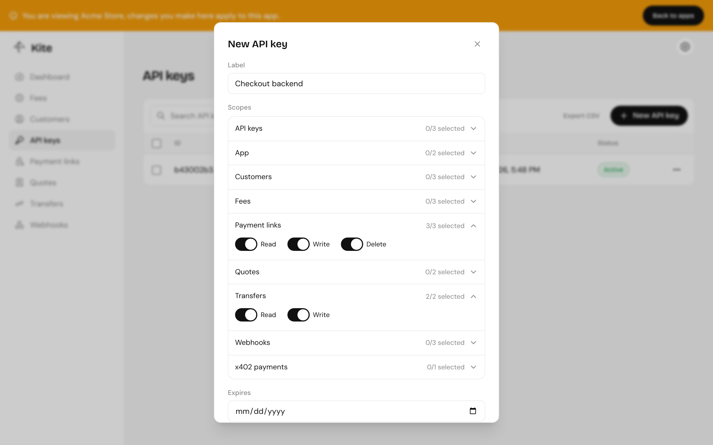
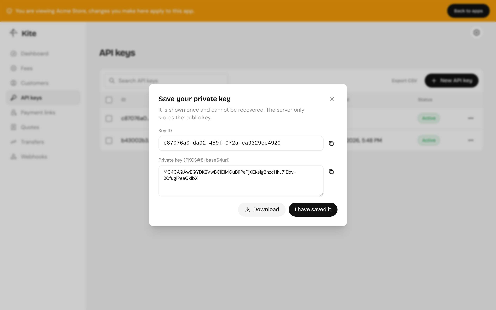
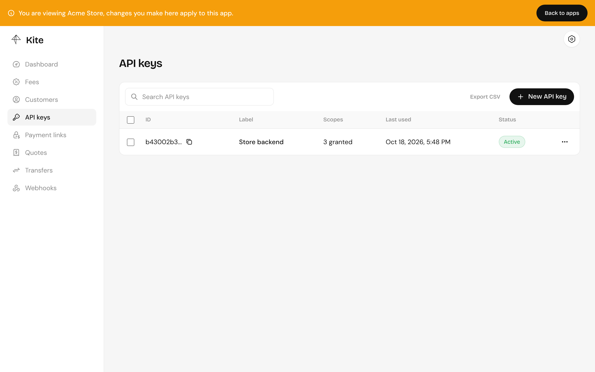

import { Aside, Tabs, TabItem } from "@astrojs/starlight/components";

## Creating a key in the dashboard

Inside an app, open **API keys** and click **New API key**. Give it a label, pick its scopes and, optionally, an expiry date.



The dashboard generates the key pair in your browser and registers only the public key. Copy or download the key ID and private key: they're shown once.



<Aside type="caution">
  Store the private key like a password, in your secret manager or environment.
  If you lose it, revoke the key and create another.
</Aside>

## Creating a key through the API

Generate a key pair yourself, then register the public half. The public key is the raw 32-byte Ed25519 key in base64url (43 characters); the private key is PKCS#8 DER in base64url, which is what `@kite-01/sdk` expects.

```ts
import { generateKeyPairSync } from "node:crypto";

const { publicKey, privateKey } = generateKeyPairSync("ed25519");

const publicKeyBase64url = publicKey.export({ format: "jwk" }).x;
const privateKeyBase64url = privateKey
  .export({ format: "der", type: "pkcs8" })
  .toString("base64url");
```

```http
POST /api/api-key
x-kite-root-key: <root key>
x-kite-app-id: <app id>
content-type: application/json

{
  "label": "Checkout backend",
  "publicKey": "<publicKeyBase64url>",
  "scopes": ["PaymentLink:Read", "PaymentLink:Write", "Transfer:Read"],
  "expiresAt": "2027-01-01T00:00:00.000Z"
}
```

A key with `Apikey:Write` can create keys for its own app, but never with scopes it doesn't hold itself.

## Scopes

| Group         | Scopes                                                        |
| ------------- | ------------------------------------------------------------- |
| API keys      | `Apikey:Read`, `Apikey:Write`, `Apikey:Delete`                |
| App           | `App:Write`, `App:Delete`                                     |
| Customers     | `Customer:Read`, `Customer:Write`, `Customer:Delete`          |
| Fees          | `Fee:Read`, `Fee:Write`, `Fee:Delete`                         |
| Payment links | `PaymentLink:Read`, `PaymentLink:Write`, `PaymentLink:Delete` |
| Quotes        | `quotes:read`, `quotes:write`                                 |
| Transfers     | `Transfer:Read`, `Transfer:Write`                             |
| Webhooks      | `Webhook:Read`, `Webhook:Write`, `Webhook:Delete`             |
| x402          | `x402`                                                        |

Any valid key can read its own app and the server's chains, tokens and rates. Give each key only what it needs. A backend that creates payment links and checks transfers needs `PaymentLink:Write` and `Transfer:Read`.

## Rotating and revoking

- **Revoke** a key to stop it working at once; it stays listed so you can see when it was last used.
- **Delete** removes it entirely.
- To rotate, create a new key, deploy it, then revoke the old one.


