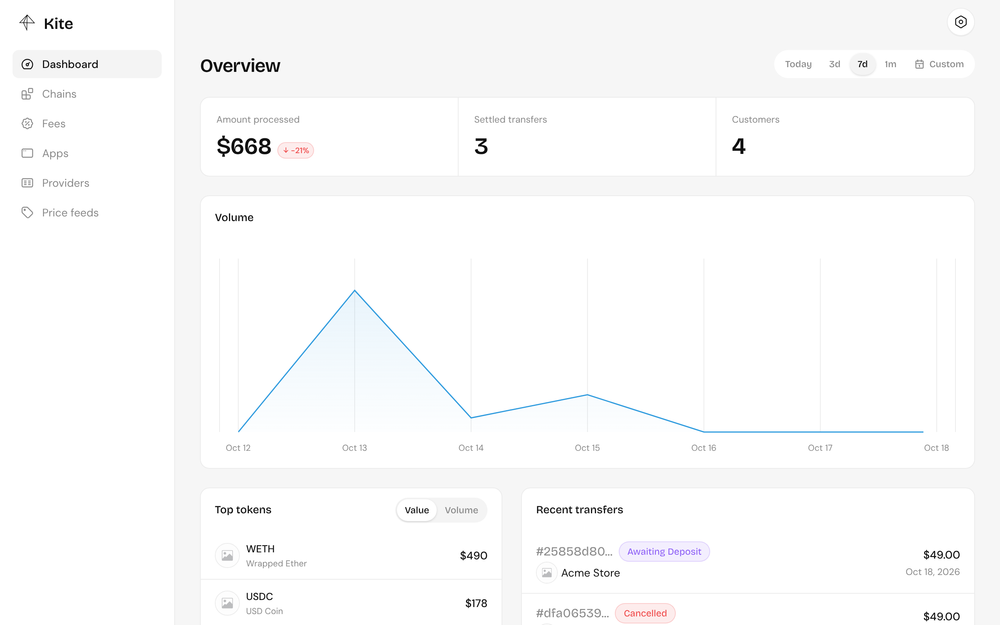

import { Card, CardGrid, LinkCard } from "@astrojs/starlight/components";

## What you get

<CardGrid>
  <Card title="Payment links and checkout" icon="seti:html">
    Price in USD or another currency, and let customers pay with any token you
    list, from a wallet or by sending to an address or QR code.
  </Card>
  <Card title="Your token out" icon="random">
    Payments in another token are swapped through Uniswap V3 and settled to you
    in the token you choose, minus your fees.
  </Card>
  <Card title="Settled on-chain" icon="approve-check">
    Every payment runs through its own contract, which settles, pays fees or
    refunds. Kite never holds funds in a shared wallet.
  </Card>
  <Card title="Built to integrate" icon="puzzle">
    A signed REST API, a typed SDK, a drop-in checkout and verified webhooks.
  </Card>
</CardGrid>

## Where to go next

<CardGrid>
  <LinkCard
    title="How Kite works"
    description="The pieces, and what happens when a customer pays."
    href="/how-kite-works/"
  />
  <LinkCard
    title="Install a server"
    description="From an empty machine to a running dashboard."
    href="/server/install/"
  />
  <LinkCard
    title="Authentication"
    description="API keys, scopes and request signing."
    href="/authentication/overview/"
  />
  <LinkCard
    title="@kite-01/sdk and @kite-01/js"
    description="Create payment links on your server and open checkout on your site."
    href="/integrate/overview/"
  />
</CardGrid>
