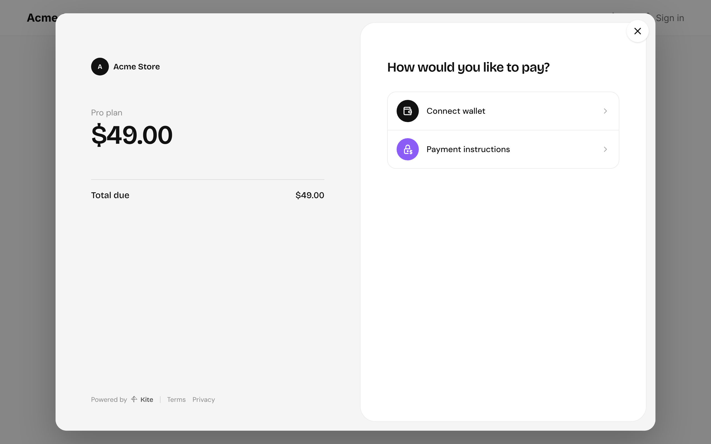

import { Steps, LinkCard, CardGrid } from "@astrojs/starlight/components";

Most integrations look the same: your backend decides what's owed, your site shows checkout, and your backend hears when it's paid.

<Steps>

1. **Your backend creates a payment link** for the order with [`@kite-01/sdk`](/integrate/sdk/), with your order ID as its `reference`, and hands the link's ID to your frontend.

   ```ts
   const { data: link } = await kite.paymentLinks.create({
     body: {
       title: "Pro plan",
       currency: "USD",
       amount: "49",
       reference: order.id,
     },
   });
   ```

2. **Your site opens checkout** over the page with [`@kite-01/js`](/integrate/checkout-js/), or sends the customer to `/pay/<id>` on your Kite server.

   ```ts
   openCheckout({ baseUrl: "https://pay.example.com", paymentLinkId });
   ```

   

3. **Kite calls your webhook** when the payment settles. Your backend [verifies it](/integrate/webhooks/), reads the `reference`, and fulfils the order.

</Steps>

The price is always set on your server, where customers can't change it. The browser only opens a link that already exists, and only a verified webhook marks an order paid.

<CardGrid>
  <LinkCard
    title="@kite-01/sdk"
    description="Signed, typed calls to your Kite server."
    href="/integrate/sdk/"
  />
  <LinkCard
    title="@kite-01/js"
    description="Checkout over your own page."
    href="/integrate/checkout-js/"
  />
  <LinkCard
    title="Webhooks"
    description="Know when payments settle."
    href="/integrate/webhooks/"
  />
  <LinkCard
    title="API Reference"
    description="Every endpoint, for any language."
    href="/api-reference/"
  />
</CardGrid>

## Not using JavaScript?

Everything the packages do is plain HTTP. Sign requests as in [Signing requests](/authentication/signing-requests/), link customers to `/pay/<id>`, and verify webhooks as in [Webhooks](/integrate/webhooks/#verifying-without-the-sdk).
