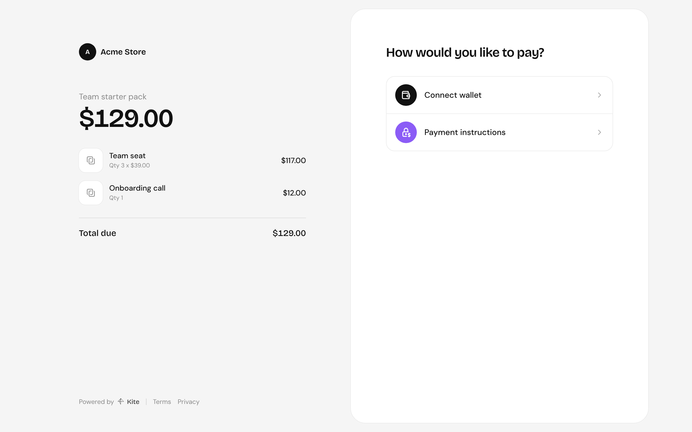
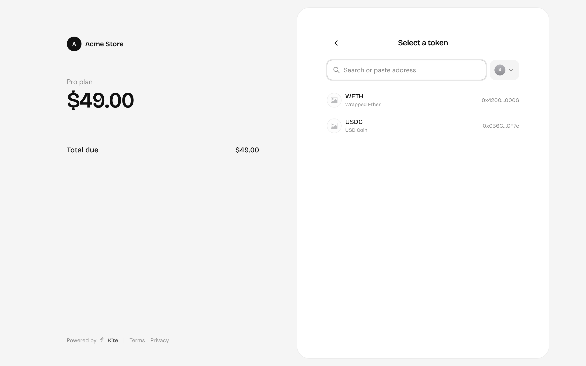
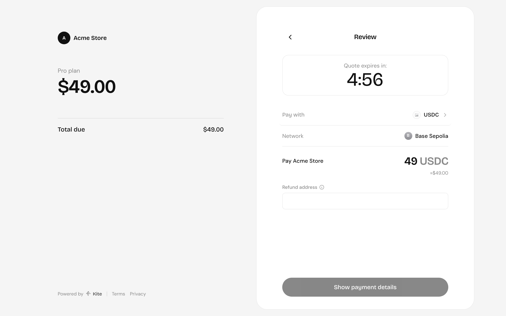
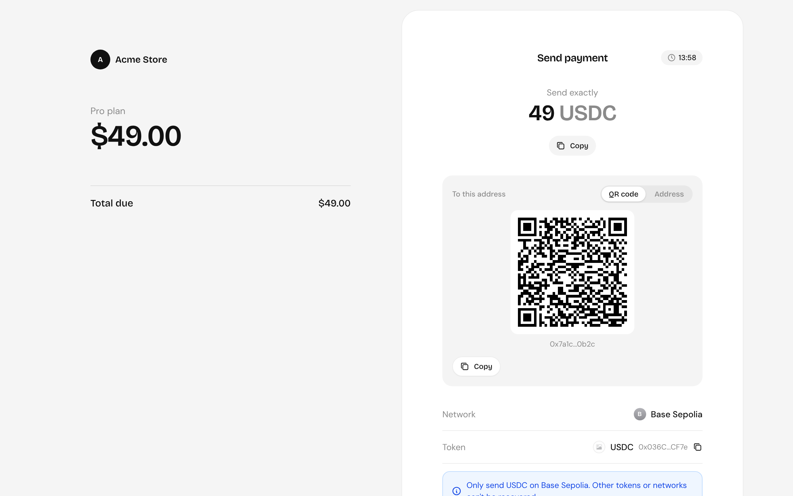
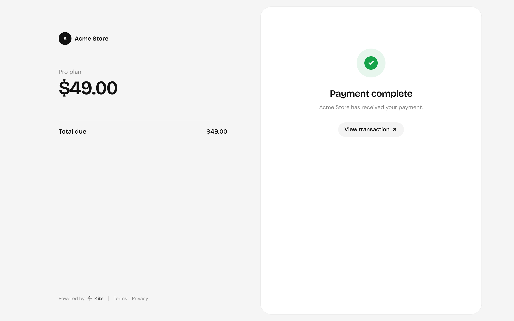

import { Steps } from "@astrojs/starlight/components";

Every payment link has a checkout page at `/pay/<payment link id>` on your server. It needs no login and no API key: anyone with the link can pay it. The same page can open over your own site with [`@kite-01/js`](/integrate/checkout-js/).

The left side shows what's being paid for: the app, the title, line items and the total. The right side takes the payment.

## Paying by sending tokens

Works with any token on any configured chain, from any wallet or exchange.

<Steps>

1. **Payment instructions**, then pick a network and token. Customers can search, or paste a token's address to pay with one that isn't listed.

   

2. **Review** the amount in that token. The quote holds for 5 minutes. The customer gives a **refund address**, where the funds go if the payment can't be completed. It should be a wallet they control, not an exchange deposit address.

   

3. **Send exactly** the amount shown to the address, as a QR code or as text. The QR code fills in the token, network and amount in wallets that support payment requests ([EIP-681](https://eips.ethereum.org/EIPS/eip-681)); the address tab is there for everything else.

   

4. The page follows the transfer and shows the result once it settles.

   

</Steps>

## Paying from a wallet

**Connect wallet** lets customers pay from a browser wallet without paying gas themselves: they sign an authorisation and the server submits it, using [x402](/payments/x402/). It's offered on chains that have a gas sponsor, for settlement tokens that support signed transfers ([EIP-3009](https://eips.ethereum.org/EIPS/eip-3009)), such as USDC.

## Payment windows

A transfer stays open until its quote expires. If nothing arrives in time, it's cancelled and the page offers to start over. If the customer sends less than the amount, or pays after the window, the funds are refunded to their refund address.
