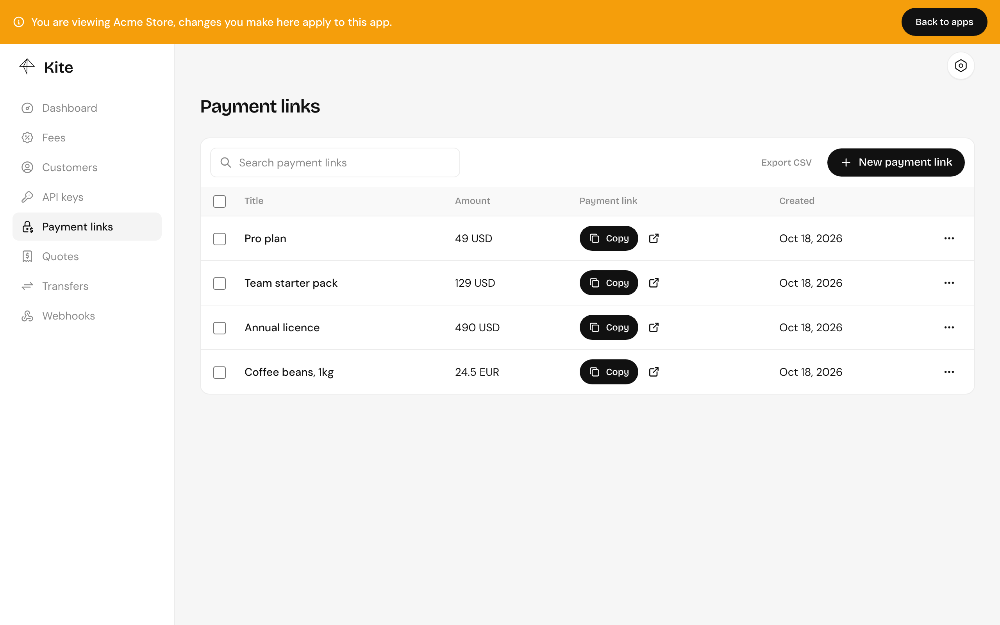
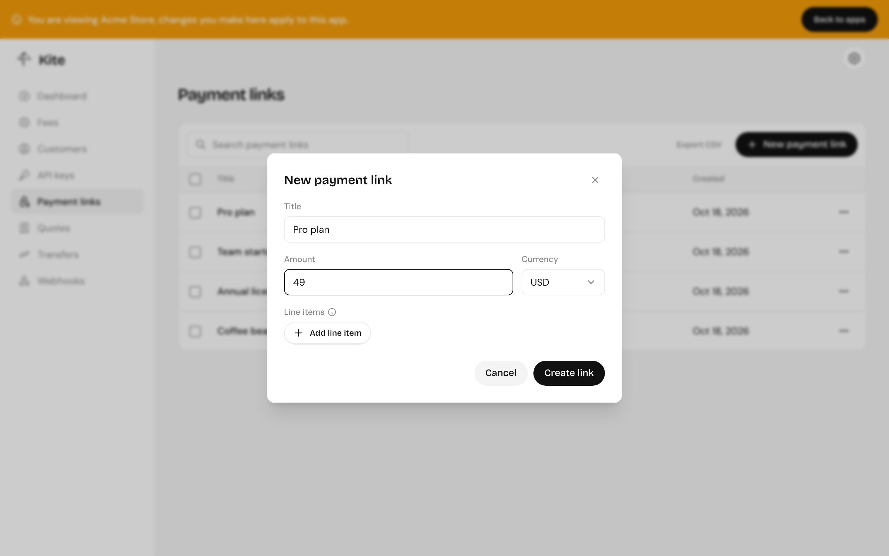

import { Aside } from "@astrojs/starlight/components";

A payment link is something to pay for: a title and an amount in a currency. Customers pay it at `/pay/<id>` on your server, or in a pop-up on your own site with [`@kite-01/js`](/integrate/checkout-js/).



## Fields

| Field       | Description                                                                                                                                 |
| ----------- | ------------------------------------------------------------------------------------------------------------------------------------------- |
| `title`     | Shown at checkout. Up to 200 characters.                                                                                                    |
| `currency`  | `USD`, or any currency you've added a [price feed](/server/chains-and-tokens/#currencies) for.                                              |
| `amount`    | A decimal string, such as `"49"` or `"12.50"`.                                                                                              |
| `lineItems` | Optional. Each has a `name`, `price`, `quantity` and optional `image`. They must add up to `amount` exactly.                                |
| `reference` | Optional. Your own ID for it, such as an order ID. Unique within the app, so creating a second link with the same reference fails with 409. |
| `meta`      | Optional JSON for your own use.                                                                                                             |

`reference` and `meta` are never shown to customers. They come back on the link, and on every transfer webhook for a payment made through it.

## Creating one

In the dashboard, under **Payment links**:



From your backend, with the [SDK](/integrate/sdk/):

```ts
const { data: link } = await kite.paymentLinks.create({
  body: {
    title: "Pro plan",
    currency: "USD",
    amount: "49",
    reference: order.id,
  },
});

const url = `https://pay.example.com/pay/${link.id}`;
```

Find it again later by reference:

```ts
const { data } = await kite.paymentLinks.list({
  query: { reference: order.id },
});
```

## One link or many

A link can be paid any number of times, so there are two ways to use them:

- **One link per order.** Your backend creates a link for each order with the order's ID as `reference`. Webhooks tell you exactly which order was paid. This is the usual choice for stores and apps.
- **One link for a product.** Create it once in the dashboard and share it, for donations, invoices sent by hand or a fixed-price product. Every payment is a separate transfer.

<Aside type="caution">
  Changing a link's amount affects payments that haven't been quoted yet, not
  ones already open.
</Aside>
