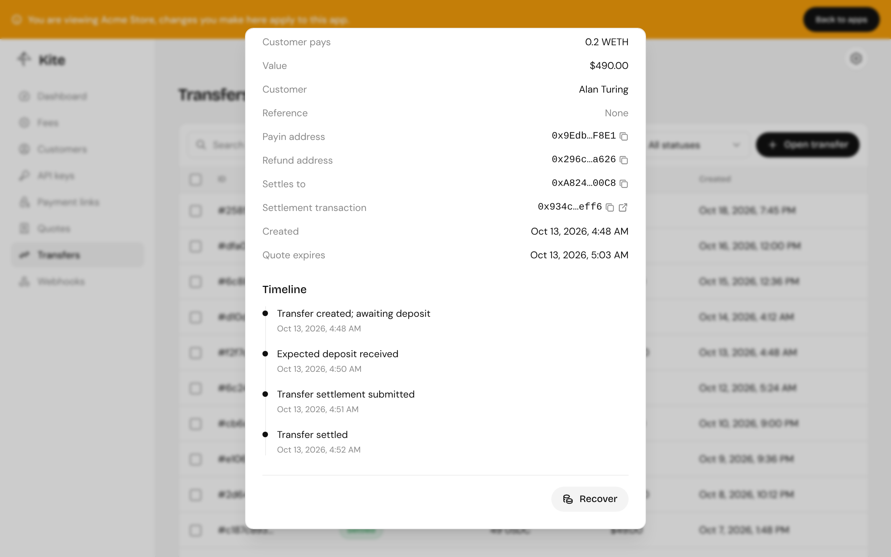

import { Aside } from "@astrojs/starlight/components";

Funds only leave a transfer's contract in three ways: settlement to you, a refund to the customer, or a recovery of tokens that don't belong to the payment. All three are sent by the operator wallet.

## Automatic refunds

Kite refunds without you doing anything when:

- the customer paid less than the amount, and the transfer expired;
- the customer paid after the transfer was cancelled;
- settlement failed, for example because a swap couldn't meet the quoted minimum.

The refund goes to the refund address the customer gave at checkout.

## Refunding by hand

Open a transfer in the dashboard and choose **Refund**, or call `POST /api/transfers/{id}/refund`. The button only appears when there's something to refund, and the API refuses, with `409`, when:

- the transfer has settled or was already refunded;
- the pay-in address is empty, as with a transfer that expired unpaid;
- the payment came through x402 and its funds are held for manual resolution.

Before a transfer expires, only the operator can refund it. After it expires, anyone can call the contract's `refund`, so a customer is never stuck waiting on the server.

## Recovery

Recovery sends a token that isn't part of the payment from the pay-in address to an address you choose: tokens sent by mistake, or a refund or overpayment the customer's address couldn't accept.

In the dashboard, choose **Recover**, check the address's balance of the token, and send it. Through the API, `POST /api/transfers/{id}/recover`. Kite refuses, with `409`, before any transaction is sent, when:

- there's none of that token at the address;
- the transfer is still open and the token is its own pay-in or settlement token. Those only leave by settling or refunding.

Kite also recovers stray tokens on its own, back to the refund address, when a deposit notifier reports them.

<Aside>
  Refunds and recoveries use the chain's gas sponsor by default. Pass
  `useGasSponsor: false` to have the operator wallet pay the gas instead; it
  then needs some of the chain's native token.
</Aside>
