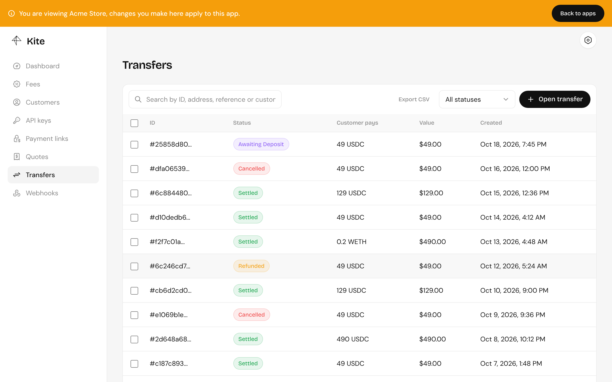
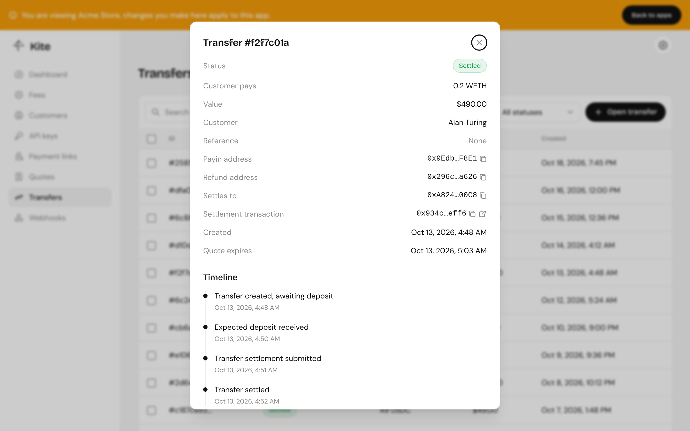

A transfer is one payment of a quote. It has its own pay-in address, the address of its [Kite contract](/contracts/overview/), and moves through statuses as the payment progresses. Each change is recorded on its timeline and sent to your [webhooks](/integrate/webhooks/).



## Statuses

| Status            | Meaning                                                                                                               |
| ----------------- | --------------------------------------------------------------------------------------------------------------------- |
| `Created`         | Being set up. Rarely seen.                                                                                            |
| `AwaitingDeposit` | Open, waiting for the customer to pay.                                                                                |
| `DepositReceived` | The full amount arrived at the pay-in address.                                                                        |
| `x402Settled`     | An x402 payment was accepted and the funds are at the pay-in address.                                                 |
| `Processing`      | The settlement transaction was sent.                                                                                  |
| `Settled`         | **Paid.** Swapped if needed, fees paid, and the rest sent to the settlement address.                                  |
| `Cancelled`       | Expired without payment.                                                                                              |
| `Failed`          | Settlement couldn't complete. The funds are refunded automatically, unless the payment came through x402 (see below). |
| `Refunded`        | The funds went back to the refund address.                                                                            |

`Settled` is the only status that means you've been paid. Fulfil orders on it.

## The timeline

Open a transfer to see its details and every step it went through, with links to the transactions.



## Late and partial payments

- **Less than the amount**: the transfer waits until the quote expires, then the funds are refunded.
- **More than the amount**: the payment settles and the excess goes back to the customer.
- **After the transfer was cancelled**: the funds are refunded.
- **A different token than quoted**: it's sent back to the refund address automatically. See [Refunds and recovery](/payments/refunds-and-recovery/).

## Opening transfers yourself

Checkout opens transfers for you. Through the API, a transfer is opened for a quote:

```ts
const { data: quote } = await kite.quotes.create({
  body: { chainId, sourceTokenAddress, amount: "49000000" },
});

const { data: transfer } = await kite.transfers.create({
  body: { quoteId: quote.id, refundAddress: customerWallet },
});

transfer.paymentInstructions;
// { caip2Id, address, tokenAddress, amount, expiresAt }
```

`amount` is what the customer pays, in the smallest unit of `sourceTokenAddress` (`49000000` is 49 USDC, which has 6 decimals). A quote can only be used once.
