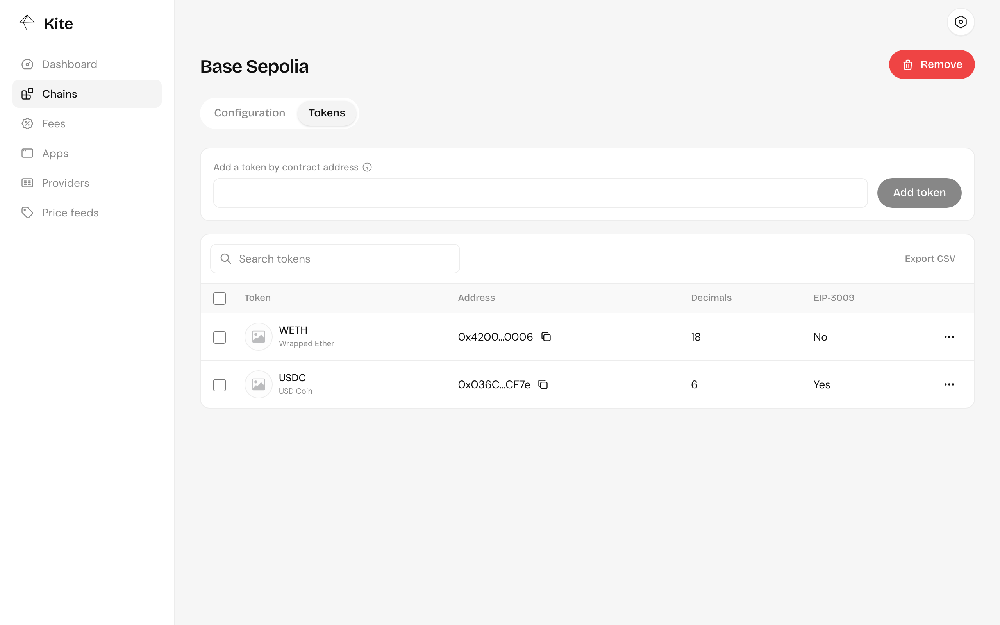
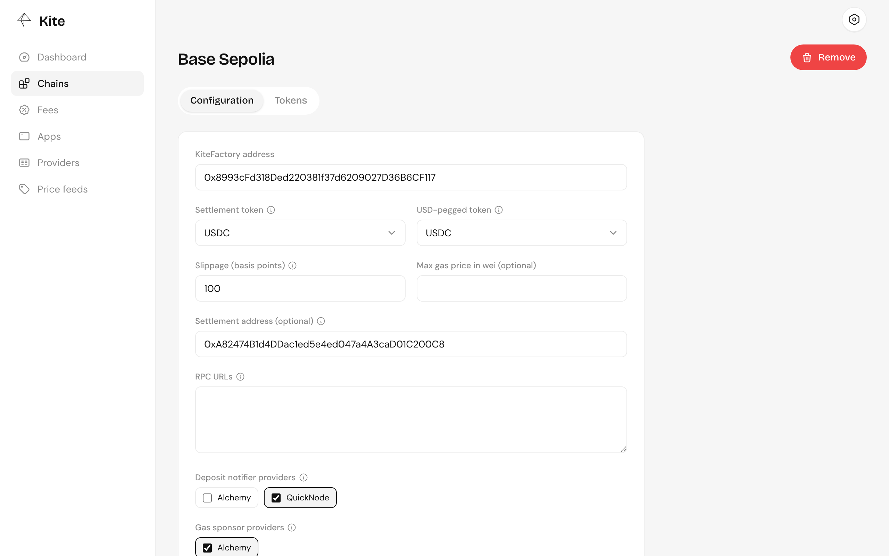

import { Aside } from "@astrojs/starlight/components";

A chain is a network your server accepts payments on. Add it under **Chains**, list its tokens, then configure it. A chain that's added but not configured doesn't appear at checkout.

## Tokens

In the chain's **Tokens** tab, add each token customers may pay with by its contract address. Kite reads its name, symbol and decimals from the chain.

Customers can pay with any listed token. Tokens other than the settlement token are swapped when the payment settles, so each needs a Uniswap V3 pool with the settlement token. A customer can also paste in any other token's address at checkout; it's priced the same way, if a pool exists.

## Configuration

| Field                   | What it does                                                                                                                       |
| ----------------------- | ---------------------------------------------------------------------------------------------------------------------------------- |
| **KiteFactory address** | The Kite factory deployed on this network. See [deployments](/contracts/overview/#deployments).                                    |
| **Settlement token**    | What payments are settled in, such as USDC. Add it in Tokens first.                                                                |
| **USD-pegged token**    | A token worth $1, used to value payments in USD for quotes, fees and stats. Usually the same USDC.                                 |
| **Slippage**            | How far, in basis points, a swap may fall short of the quoted price. `100` is 1%.                                                  |
| **Max gas price**       | Optional ceiling, in wei, on the gas price the operator will pay.                                                                  |
| **Settlement address**  | Where settled funds go. Leave it empty to use the operator wallet.                                                                 |
| **RPC URLs**            | Your own RPC endpoints, one per line. Public RPCs are used as a fallback, but they're rate-limited, so use your own in production. |
| **Deposit notifiers**   | Which [providers](/server/providers/) watch this chain for deposits. Only providers with keys set can be chosen.                   |
| **Gas sponsors**        | Which providers pay gas for settlement on this chain.                                                                              |

<Aside type="caution">
  The settlement address receives real funds. Use a wallet you control and can
  sign from, not an exchange deposit address.
</Aside>

## Pricing

Quotes for tokens other than the settlement token come from Uniswap V3 time-weighted average prices, not the pools' spot price, so a single trade can't move a quote. For each pair, Kite reads every fee tier's pool from the factory behind the chain's swap router, averages the price over the last 10 minutes (falling back to 5, then 1, for pools with less history) and prices from the deepest pool. The swap then uses that pool, and the slippage setting protects the settlement if the spot price has moved away from the average.

## Currencies

Payment links can be priced in USD out of the box. To price in another currency, add a Chainlink price feed for it under **Price feeds**: its pair and decimals are read from the contract, and the currency becomes available once a feed quotes it in USD.

## Turning a chain off

The **Active** switch hides a chain from checkout without losing its configuration.
