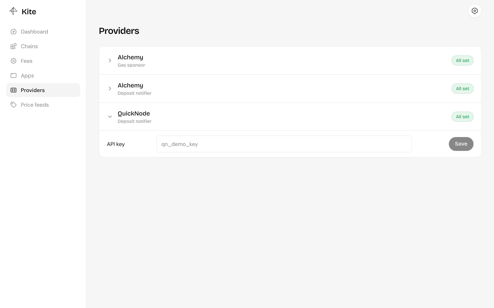

import { Aside } from "@astrojs/starlight/components";

Kite uses outside providers for two jobs, and every chain needs one of each: a deposit notifier and a gas sponsor. Set their keys under **Providers** in the dashboard; they're stored encrypted with your `KITE_ENCRYPTION_KEY`.

## Deposit notifiers

A deposit notifier watches every pay-in address and calls your server when tokens arrive, so payments settle within seconds. Kite creates the provider's webhooks itself, one per network, the first time a chain needs one.

| Provider  | Key        | Where to get it                           |
| --------- | ---------- | ----------------------------------------- |
| QuickNode | API key    | QuickNode dashboard → API keys            |
| Alchemy   | Auth token | Alchemy dashboard → Webhooks → Auth token |

Callbacks arrive at `KITE_PUBLIC_BASE_URL/callback/...`, so that URL must be reachable from the internet. Each callback is verified with the provider's signature before Kite trusts it.

Choose which notifier each chain uses in the chain's configuration. A chain can use more than one.

<Aside>
  Changing a notifier's key removes the webhooks made with the old one, and Kite
  creates new ones as transfers need them.
</Aside>

## Gas sponsors

A gas sponsor pays the gas for the operator's transactions: settlements, refunds and recoveries. The operator wallet doesn't need native tokens.

| Provider | Keys                      |
| -------- | ------------------------- |
| Alchemy  | API key and gas policy ID |

Choose it per chain in the chain's configuration. A refund or recovery can [opt out of it](/payments/refunds-and-recovery/), in which case the operator wallet pays.
